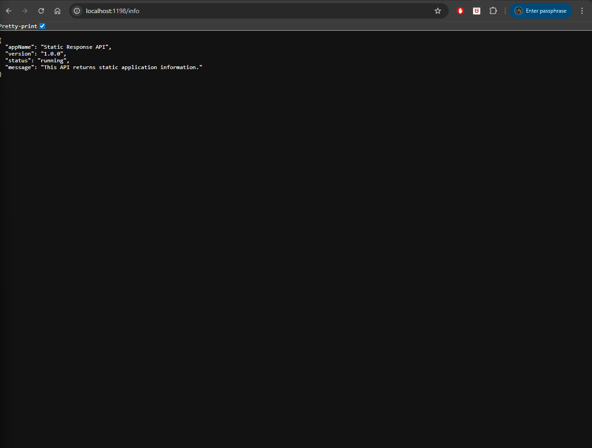

# express-project-02-static-response-api

A simple Express.js backend API that returns static application information.

## Project Goal

This project demonstrates how to create a basic Express.js API that returns static data such as application name, version, and status.

## Tech Stack

- Node.js
- Express.js

## Installation

Clone the repository

```bash
git clone https://github.com/a2rp/express-project-02-static-response-api.git
cd express-project-02-static-response-api
```

## Install dependencies

```bash
npm install
```

## Run the Project

```bash
npm start
```

The server runs at `http://localhost:1198` by default.

## API Endpoint

- GET /info

Returns static application information

---

## Example response

```json
{
    "appName": "Static Response API",
    "version": "1.0.0",
    "status": "running",
    "message": "This API returns static application information."
}
```



---

## Learning Outcome

By building this project you learn how to

- create an Express server
- define API routes
- return JSON responses
- structure a simple backend project

---

## Follow me

- GitHub: https://github.com/a2rp
- Portfolio: https://www.ashishranjan.net
- LinkedIn: https://www.linkedin.com/in/aashishranjan
- Facebook: https://www.facebook.com/theash.ashish/

## Links

- Portfolio: [https://www.ashishranjan.net](https://www.ashishranjan.net)
- GitHub: [https://github.com/a2rp](https://github.com/a2rp)
- CodePen: [https://codepen.io/ash1198](https://codepen.io/ash1198)
- LinkedIn: [https://www.linkedin.com/in/aashishranjan](https://www.linkedin.com/in/aashishranjan)
- Facebook: [https://www.facebook.com/theash.ashish/](https://www.facebook.com/theash.ashish/)
- YouTube: [https://www.youtube.com/@ashishranjan-ashz?sub_confirmation=1](https://www.youtube.com/@ashishranjan-ashz?sub_confirmation=1)
- Email: [ash.ranjan09@gmail.com](mailto:ash.ranjan09@gmail.com)

## Support

- Support: [https://a2rp-donation-page.netlify.app/](https://a2rp-donation-page.netlify.app/)
- Buy Me A Coffee: [https://buymeacoffee.com/a2rp](https://buymeacoffee.com/a2rp)
- Patreon: [https://patreon.com/a2rp](https://patreon.com/a2rp)
